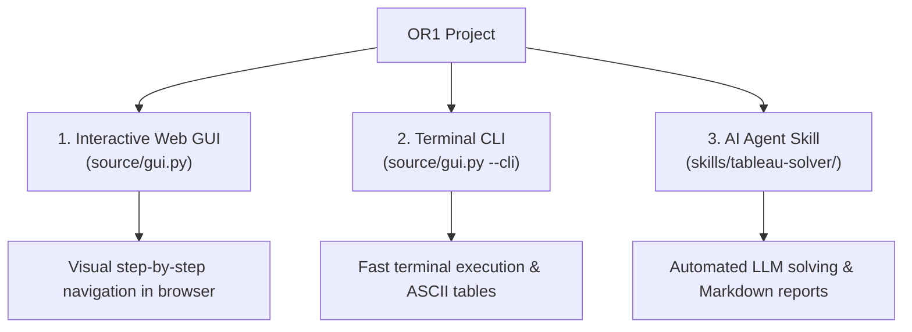

# Human Guide & Instructions for OR1 Simplex Solver

Welcome to **OR1** (*Operations Research 1*), a complete, dependency-free toolkit for studying, solving, and visualizing **Linear Programming (LP)** problems using the **Simplex Method**, **Bland's Anti-Cycling Rule**, and **Two-Phase Simplex**.

This guide is written for humans (students, researchers, professors, and developers) who want to understand how the project works, how to use it, and how to get the most out of its features.

---

## What Does This Project Do?

Linear programming is at the heart of operations research, logistics, finance, and engineering. However, learning or implementing the Simplex algorithm comes with major challenges:
1. **Arithmetic errors**: Manual calculations with fractions are tedious and error-prone. Floating-point numbers in standard code produce rounding artifacts (e.g. `0.33333333` instead of `1/3`).
2. **Degeneracy & Cycling**: Certain linear programs cause standard simplex rules (like Dantzig's rule) to loop infinitely among degenerate bases without ever reaching the optimal solution.
3. **Infeasible Origins**: Many real-world problems do not have an obvious starting solution at $x = 0$ (e.g. constraints with $\ge$ or $=$), requiring artificial variables and the Two-Phase method.

**OR1 solves all of these problems**:
- **100% Exact Rational Arithmetic**: Built using Python's standard `fractions.Fraction`. All calculations are irreducible integers and fractions ($1/2, -11/2, 27/4$), with zero floating-point error.
- **Bland's Smallest-Subscript Rule**: Deterministically resolves ties for entering and leaving variables, mathematically guaranteeing termination without cycling.
- **Full Two-Phase Simplex**: Automatically introduces artificial variables ($y_1, \dots, y_m$) to find feasible starting bases, then optimizes the original objective.
- **Zero External Dependencies**: Works immediately on any standard Python 3 installation without installing pip packages.

---

## 3 Ways to Use This Project

You can interact with the project in three different ways depending on your needs:



---

### Method 1: Interactive Web GUI (Recommended for Learning)

The Web GUI provides a clean, responsive web interface to visualize tableaus, step through Gaussian row operations, inspect ratio tests, and see colors for basic vs. non-basic columns.

#### How to start:
From your terminal, run:
```bash
python3 source/gui.py
```
Then open your browser at **`http://localhost:8000`** (it usually opens automatically).

#### Features in the GUI:
* **Tableau View**: See the tableau with the **RHS on the left** and colored columns (Red for basic variables, Blue for non-basic, Yellow for artificial variables, Green for Row 0 reduced costs).
* **Step-by-Step Navigation**:
  * **Iteration controls**: Skip forward or backward across iterations.
  * **Sub-step controls**: Walk through the exact sub-steps:
    1. *Select Pivot* (Bland candidate selection + Minimum Ratio $\theta$ test).
    2. *Normalize Pivot Row* ($R_p \leftarrow \frac{1}{a_{pq}} R_p$).
    3. *Gauss-Jordan Elimination* (row by row, driving other column entries to 0).
    4. *Iteration Complete* (updated basis).
* **Load CSV Tableaus**: Switch between built-in problems (`csv/tableau.csv`, `csv/example_standard.csv`) or any custom CSV in the `csv/` folder.
* **Manual Input Page**: Enter a custom objective function and constraints in a form, with an optional toggle to force Two-Phase Simplex.

---

### Method 2: Terminal CLI (Fast Execution)

If you prefer working directly inside your terminal:

```bash
# Solve a CSV file via CLI
python3 source/gui.py csv/tableau.csv --cli

# Or enter an LP interactively via CLI prompts
python3 source/gui.py --cli
```

The CLI prints beautifully formatted ASCII tables with colored terminal headers, explicit ratio tests, and Gaussian row elimination formulas after every iteration.

---

### Method 3: AI Agent / LLM Skill (`skills/tableau-solver/`)

If you are using an AI coding assistant (**Antigravity**, **Claude Code**, **Codex**, **Cursor**, or **GitHub Copilot**), this project provides a modular skill that teaches the AI how to solve tableaus without making mental math errors.

#### Direct Command Line:
```bash
# 1. Solve from a CSV file
python3 skills/tableau-solver/scripts/solve_tableau.py --csv csv/tableau.csv

# 2. Solve from raw tableau text (e.g. pasted into a prompt)
python3 skills/tableau-solver/scripts/solve_tableau.py --raw "Basis,RHS,x1,x2\n-z,0,-3,-5\nx3,4,1,0\nx4,12,0,2\nx5,18,3,2"

# 3. Solve an algebraic problem
python3 skills/tableau-solver/scripts/solve_tableau.py --lp "min 4*x1 + x2 s.t. 3*x1 + x2 = 3; 4*x1 + 3*x2 >= 6; x1 + 2*x2 <= 4; x1, x2 >= 0"

# 4. Export the entire mathematical solution to a Markdown report
python3 skills/tableau-solver/scripts/solve_tableau.py --csv csv/tableau.csv --output-md solution.md
```

#### In the AI Chat:
You can simply tell your AI assistant:
> *"Solve the tableau in `csv/tableau.csv` and show all iterations with formulas."*
> or
> *"Solve this LP using Bland's rule and create a solution.md file: min 4x1 + x2 subject to 3x1 + x2 = 3, 4x1 + 3x2 >= 6, x1 + 2x2 <= 4."*

The AI assistant will automatically use the skill, execute the script, and report the verified results without guessing numbers!

---

## Mathematical Conventions Explained

To avoid ambiguity between different textbooks, this solver follows clear, consistent rules:

### 1. Universal Minimization ($\min z$)
Every problem is treated as a minimization problem:
$$\min_{\mathbf{x}} \; \mathbf{c}^T \mathbf{x} \quad \text{subject to} \quad A\mathbf{x} = \mathbf{b}, \quad \mathbf{x} \ge 0$$
If a maximization objective is provided, it is negated:
$$\max f(\mathbf{x}) \iff \min -f(\mathbf{x})$$

### 2. Row 0 Convention & Identity
Row 0 in the tableau represents the equation:
$$-z + \sum_{j \in \text{Non-Basic}} \bar{c}_j x_j = \text{RHS}_0$$
* At any basic feasible solution (where all non-basic $x_j = 0$):
  $$-z = \text{RHS}_0 \implies z = -\text{RHS}_0$$
* **When optimal**:
  $$\min z^* = -\text{RHS}_0$$
  *(For example, if Row 0 ends with $\text{RHS}_0 = 1$, the true minimum is $z^* = -1$).*

### 3. Bland's Smallest-Subscript Anti-Cycling Rule
When multiple variables qualify to enter or leave the basis:
* **Entering variable**: Choose the variable with the **smallest index** among all candidates having strictly negative reduced costs ($c_j < 0$).
* **Leaving variable**: Choose the variable with the **smallest index** among all rows tied for the minimum ratio $\theta = \text{RHS}_i / a_{ij}$ ($a_{ij} > 0$).
* **Beale's Benchmark**: Standard Dantzig simplex cycles endlessly in a 6-tableau loop on `csv/tableau.csv`. Bland's rule breaks the ties and terminates in 7 iterations at the true optimum $\min z^* = -1$.

### 4. Two-Phase Simplex Method
When constraints include $\ge$, $=$, or negative RHS values:
* **Phase 1**: Normalizes RHS values to be non-negative, adds artificial variables $y_1, \dots, y_m$, and minimizes $W = \sum y_i$. If $\min W^* > 0$, the problem is **infeasible**. If $\min W^* = 0$, a feasible basis has been found.
* **Phase 2**: Drops the artificial variables, restores the original objective row ($-z$), canonicalizes Row 0 against the Phase 1 basis, and optimizes.

---

## File & Directory Structure

```text
.
├── CLAUDE.md                 # Configuration for Claude Code assistant
├── AGENTS.md                 # Universal configuration for Codex & open agents
├── .cursorrules              # Configuration for Cursor AI editor
├── INSTRUCTIONS.md           # This guide (for human users)
├── README.md                 # Technical specification & API documentation
├── LICENSE                   # Open-source MIT license
├── csv/                      # Tableau dataset files
│   ├── tableau.csv           # Beale's 1955 cycling benchmark
│   └── example_standard.csv  # Standard 2D textbook LP problem
├── skills/
│   └── tableau-solver/       # Self-contained AI skill & calculation engine
│       ├── SKILL.md          # Agent prompt specification & instructions
│       ├── scripts/
│       │   └── solve_tableau.py # Pure-Python solver & calculation script
│       ├── references/       # Mathematical cheatsheet & syntax guides
│       └── examples/         # Sample inputs, prompts, and solution.md
└── source/
    └── gui.py                # Web GUI server, HTTP API, and CLI runner
```

---

## How to Create Your Own CSV Tableau

You can add any custom problem by creating a `.csv` file in the `csv/` folder:

### Recommended Format (RHS on Left):
```csv
Basis,RHS,x1,x2,x3,x4,x5
-z,0,-3,-5,0,0,0
x3,4,1,0,1,0,0
x4,12,0,2,0,1,0
x5,18,3,2,0,0,1
```
* **Separators**: Comma (`,`), Semicolon (`;`), or Tab (`\t`).
* **Numbers**: Integers (`4`), standard fractions (`1/2`, `-11/2`), decimals (`0.5` or `0,5`).
* **Row 0**: Must start with `-z` (or `-w` for Phase 1).

Once saved in `csv/my_problem.csv`, you can immediately select it in the Web GUI dropdown or run:
```bash
python3 source/gui.py my_problem.csv --cli
```

---

## Optional SciPy Validation

The solver is 100% self-sufficient using Python's standard library. However, if you have **SciPy** installed, `solve_tableau.py` will automatically cross-validate its solution against `scipy.optimize.linprog(method='highs')`.

To install SciPy permanently on macOS:
```bash
brew install scipy
# or:
python3 -m pip install --user scipy numpy
```

---

## License
This project is licensed under the permissive [**MIT License**](LICENSE), allowing free use, modification, and redistribution for academic, personal, or commercial purposes.
