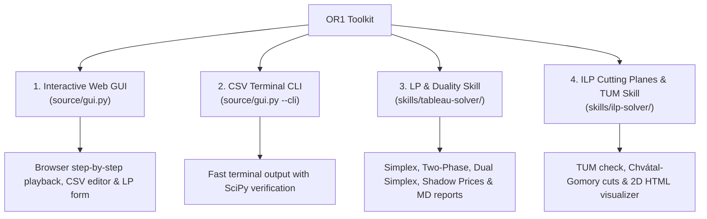

# Human Guide & Instructions for OR1

Welcome to **OR1** (*Operations Research 1*), an exact-arithmetic toolkit for studying, solving, verifying, and visualizing **Linear Programming (LP)** and **Integer Linear Programming (ILP)** problems.

This guide is written for students, researchers, instructors, and developers who want a practical walkthrough of everything the repository can do.

---

## What Does This Project Do?

Operations research calculations quickly break down in standard tools for several reasons:

1. **Floating-point rounding drift**: Numerical code turns `1/3` or `103/26` into noisy decimals, distorting pivot choices and cutting planes.
2. **Degeneracy and Simplex cycling**: Naive pivot selection (such as Dantzig's most-negative cost rule) can loop indefinitely on degenerate problems like Beale's 1955 example.
3. **No trivial starting basis**: Problems with `>=` or `=` constraints require Two-Phase Simplex or Dual Simplex.
4. **Integrality requirements**: Solving an ILP requires knowing whether the constraint matrix is already Totally Unimodular (an Ideal Polyhedron with integer vertices) or whether Chvátal-Gomory cuts must be derived to slice off fractional optima.

**OR1 addresses all four cleanly**:
- **Exact Rational Arithmetic**: Uses Python's `fractions.Fraction` throughout every solver and visualizer.
- **Bland's Smallest-Subscript Rule**: Deterministically breaks entering and leaving ties to guarantee finite termination.
- **Full Two-Phase, Dual Simplex, and Duality Support**: Computes exact shadow prices, formulates the dual LP, and verifies Strong Duality and Complementary Slackness.
- **Pre-Solve TUM Check & Chvátal-Gomory Cuts**: Detects Ideal Polyhedra (Hoffman-Kruskal) and derives Gomory cuts with interactive 2D plots.
- **Zero Mandatory External Dependencies**: Everything runs out of the box with Python 3 (and optionally cross-checks against SciPy HiGHS when installed).

---

## Four Ways to Use OR1



---

### Method 1: Interactive Web GUI (Recommended for Learning LP & Simplex)

Start the local web application from the repository root:

```bash
python3 source/gui.py
```

The server picks the first available port starting at `5050` on `127.0.0.1` (default: **`http://127.0.0.1:5050`**) and opens your default browser automatically.

**Features inside the GUI:**
- **Color-Coded Tableau View**: Distinguishes basic variables, non-basic variables, artificial variables `y_i`, Row 0 reduced costs, and RHS (placed on the left).
- **Sub-Step Navigation**: Step iteration-by-iteration or sub-step-by-sub-step through:
  1. *Select Pivot* (Bland candidates + minimum $\theta$ ratio test)
  2. *Normalize Pivot Row* ($R_p \leftarrow \frac{1}{a_{pq}} R_p$)
  3. *Gauss-Jordan Elimination* (driving non-pivot column entries to $0$)
  4. *Iteration Complete* (updated basis)
- **CSV Loader & Live Editor**: Inspect, edit, and save tableaus in `csv/`.
- **Manual LP Input & Built-in Benchmarks**: Enter custom constraints directly or run built-in `beale`, `twophase`, and `standard2d` demos, each automatically checked against SciPy if available.

---

### Method 2: CSV Terminal CLI

Solve any CSV tableau directly in your terminal without launching a browser:

```bash
# Using a path relative to root
python3 source/gui.py csv/tableau.csv --cli

# Or by filename (auto-resolved from csv/)
python3 source/gui.py example_standard.csv --cli
```

---

### Method 3: LP, Two-Phase & Duality Skill (`skills/tableau-solver/`)

Run the standalone LP solver script directly or let your AI assistant execute it for you:

```bash
# 1. Solve a CSV tableau with SciPy cross-check
python3 skills/tableau-solver/scripts/solve_tableau.py --csv csv/example_standard.csv --verify-scipy

# 2. Solve from raw inline tableau text
python3 skills/tableau-solver/scripts/solve_tableau.py \
  --raw "Basis,RHS,x1,x2\n-z,0,-3,-5\nx3,4,1,0\nx4,12,0,2\nx5,18,3,2"

# 3. Solve an LP, formulate its Dual problem, and export a Markdown report
python3 skills/tableau-solver/scripts/solve_tableau.py \
  --lp "min 4*x1 + x2 s.t. 3*x1 + x2 = 3; 4*x1 + 3*x2 >= 6; x1 + 2*x2 <= 4; x1, x2 >= 0" \
  --show-dual --output-md solution.md --verify-scipy

# 4. Run Dual Simplex on a dual-feasible tableau (c_j >= 0, negative RHS)
python3 skills/tableau-solver/scripts/solve_tableau.py \
  --lp "min 2*x1 + 3*x2 s.t. x1 + x2 >= 2; 2*x1 + x2 >= 3; x1, x2 >= 0" \
  --dual-simplex
```

In an AI chat, you can ask:
> *"Solve the tableau in `csv/tableau.csv`, verify duality, and export `solution.md`."*

---

### Method 4: ILP Cutting Planes, TUM & 2D Visualizer (`skills/ilp-solver/`)

Analyze Total Unimodularity and solve pure Integer Linear Programs using Chvátal-Gomory cuts and Dual Simplex re-optimization:

```bash
# 1. Solve the classic 2D non-TUM ILP and create an interactive 2D HTML plot
python3 skills/ilp-solver/scripts/solve_ilp.py \
  --lp skills/ilp-solver/examples/gomory_2d.lp \
  --visualize-2d cuts_visualization.html --verify-scipy

# 2. Test Total Unimodularity & Hoffman-Kruskal Ideal Polyhedron detection
python3 skills/ilp-solver/scripts/solve_ilp.py --example tum --verify-scipy

# 3. Solve an inline ILP directly and export Markdown notes
python3 skills/ilp-solver/scripts/solve_ilp.py \
  --lp "max 2*x1 + 3*x2 s.t. 2*x1 + 5*x2 <= 16; 6*x1 + 2*x2 <= 27; x1, x2 >= 0" \
  --output-md ilp_solution.md
```

Open `cuts_visualization.html` (or the pre-built [skills/ilp-solver/examples/gomory_2d_viz.html](skills/ilp-solver/examples/gomory_2d_viz.html)) in any browser to step backward and forward through each Chvátal-Gomory hyperplane over the $\mathbb{Z}^2$ integer lattice.

---

## Mathematical Conventions Explained

### 1. Universal Minimization ($\min z$) & Row 0 Identity

Every LP tableau uses minimization form:

$$
\min_{\mathbf{x}} \; \mathbf{c}^T \mathbf{x} \quad \text{subject to} \quad A\mathbf{x} = \mathbf{b}, \quad \mathbf{x} \ge 0
$$

Maximization objectives $\max f(\mathbf{x})$ are negated to $\min (-f(\mathbf{x}))$. Row 0 represents:

$$
-z + \sum_{j \in \text{Non-Basic}} \bar{c}_j x_j = \text{RHS}_0
$$

At any basic feasible solution (where non-basic variables are $0$):

$$
-z = \text{RHS}_0 \implies z = -\text{RHS}_0
$$

*(For example, Beale's problem finishes with $\text{RHS}_0 = 1$, so $\min z^* = -1$.)*

### 2. Bland's Smallest-Subscript Anti-Cycling Rule

- **Entering variable**: Pick the smallest variable index with strictly negative reduced cost ($\bar{c}_j < 0$).
- **Leaving variable**: Pick the row minimizing $\theta_i = \text{RHS}_i / a_{ij}$ among $a_{ij} > 0$, breaking ties by smallest basic variable index.

### 3. Two-Phase Simplex & Dual Simplex

- **Two-Phase**: Normalizes $\text{RHS} \ge 0$, introduces artificial variables $y_1, \dots, y_m$, minimizes $W = \sum y_i$ in Phase 1 (reporting `INFEASIBLE` if $W^* > 0$), strips artificials, restores and canonicalizes $-z$, and solves Phase 2.
- **Dual Simplex**: Requires an initial dual-feasible tableau ($\bar{c}_j \ge 0$). Selects the leaving row with the most negative RHS and applies the dual ratio test $\min_{j: a_{lj} < 0} (\bar{c}_j / |a_{lj}|)$ to restore primal feasibility.

### 4. Total Unimodularity & Chvátal-Gomory Cutting Planes

- **Total Unimodularity (TUM)**: Checks $a_{ij} \in \{-1, 0, 1\}$, bipartite network incidence criteria, Consecutive Ones structure, and exact determinants $\in \{-1, 0, 1\}$. If $A$ is TUM and $b \in \mathbb{Z}^m$, Hoffman-Kruskal guarantees $P = P_I$ and solves directly with zero cuts.
- **Cutting Planes**: For fractional basic row $x_B + \sum_{j \in N} \bar{a}_{ij} x_j = \bar{b}_i$, derives $\sum_{j \in N} f_j x_j \ge f_0$ (with $f = \cdot - \lfloor \cdot \rfloor$), converts it to original variables, appends $-s_{\text{cut}} + \sum (-f_j) x_j = -f_0$, and re-optimizes via Dual Simplex.

---

## Directory Layout

```text
.
├── .agents/skills/           # Auto-discovered skill symlinks (ilp-solver, tableau-solver)
├── INSTRUCTIONS.md           # This user guide
├── README.md                 # Complete technical specification & API reference
├── LICENSE                   # MIT License
├── csv/                      # Initial Simplex CSV datasets (tableau.csv, example_standard.csv)
├── skills/
│   ├── ilp-solver/           # TUM analysis, Chvátal-Gomory cuts & 2D HTML visualizer
│   └── tableau-solver/       # Simplex, Two-Phase, Dual Simplex, Duality & Shadow Prices
└── source/
    └── gui.py                # Web GUI server, loopback REST API & CSV CLI runner
```

---

## Creating Custom CSV Tableaus

Save any custom `.csv` file in `csv/` using left-hand RHS placement:

```csv
Basis,RHS,x1,x2,x3,x4,x5
-z,0,-3,-5,0,0,0
x3,4,1,0,1,0,0
x4,12,0,2,0,1,0
x5,18,3,2,0,0,1
```

- **Delimiters**: Comma (`,`), semicolon (`;`), or tab (`\t`).
- **Numbers**: Integers (`4`), fractions (`1/2`, `-11/2`), dot decimals (`0.5`), or European comma decimals (`0,5`).
- **Row 0**: Labeled `-z` (or `-w` during Phase 1).

After saving `csv/my_problem.csv`, refresh the Web GUI dropdown or run:

```bash
python3 source/gui.py my_problem.csv --cli
```

---

## Optional SciPy Cross-Verification

All solvers are 100% self-sufficient using the Python standard library. If `scipy` and `numpy` are installed, both `gui.py`, `solve_tableau.py`, and `solve_ilp.py` can cross-verify results against HiGHS (`scipy.optimize.linprog` / `scipy.optimize.milp`).

```bash
# macOS / pip installation
python3 -m pip install --user scipy numpy
```

---

## License

Licensed under the [**MIT License**](LICENSE).
